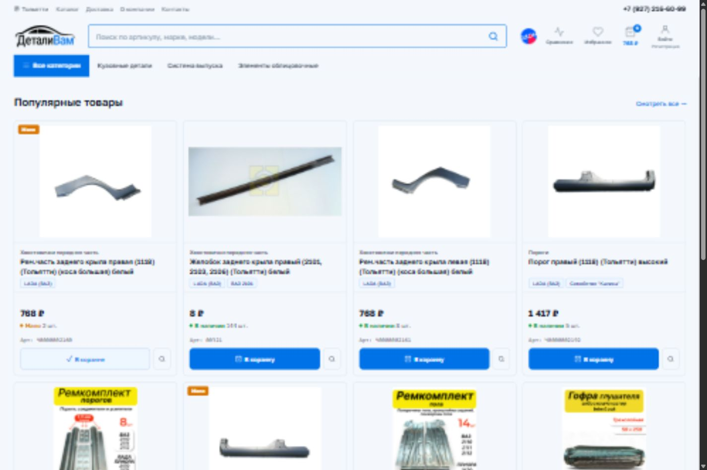
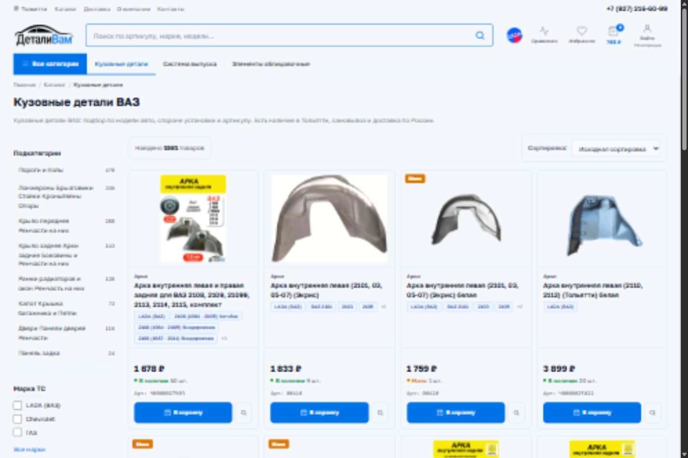
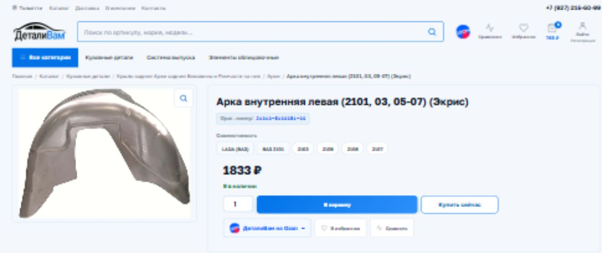
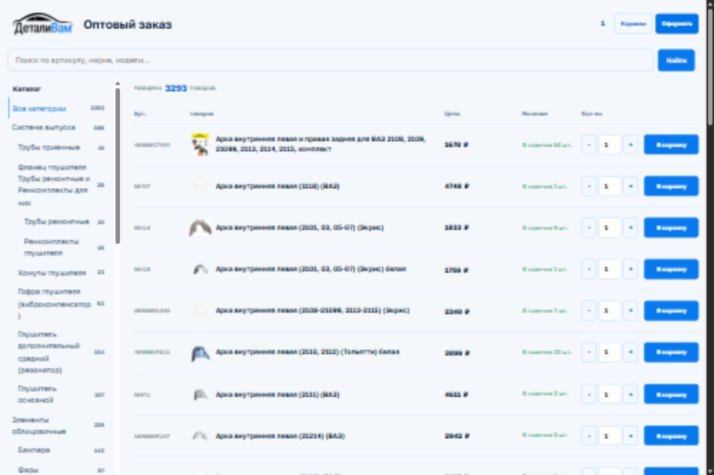
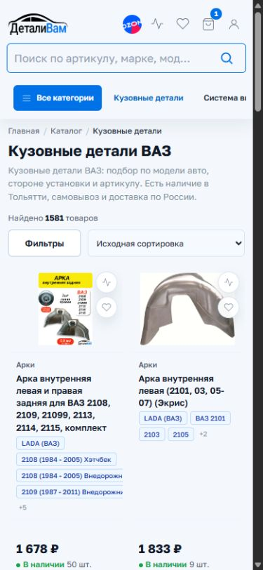
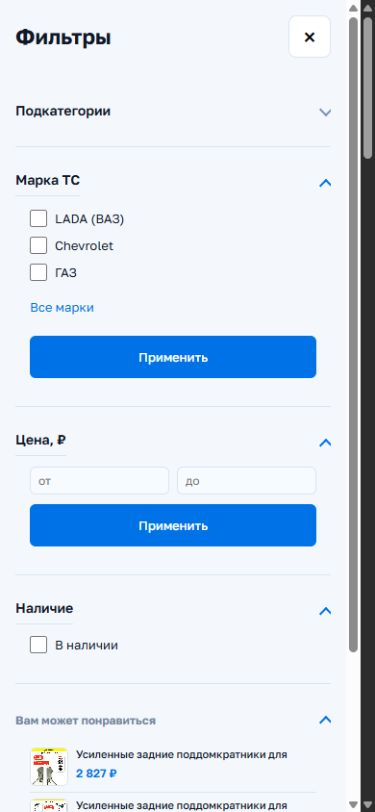

# ДеталиВам

<p align="center">
  
</p>

<p align="center"><strong>Интернет-магазин автозапчастей на WordPress и WooCommerce</strong><br>Розничный каталог · Оптовый заказ · Самовывоз · Оплата после проверки</p>

<p align="center">
  <a href="https://detalivam63.ru/">Открыть магазин</a> ·
  <a href="https://detalivam63.ru/category/kuzovnye-detali/">Посмотреть каталог</a> ·
  <a href="https://detalivam63.ru/optovik/">Оптовый заказ</a>
</p>



Самостоятельная тема WordPress и WooCommerce для интернет-магазина автозапчастей **«ДеталиВам»**. В одном проекте собраны витрина, оптовый заказ, оформление покупки, личный кабинет и инструменты управления магазином.

> Подобрать детали, оформить нужные позиции и согласовать заказ с менеджером перед оплатой.

Тема ориентирована на кузовные детали, систему выпуска и элементы облицовки. Она объединяет привычный розничный каталог и быстрый табличный подбор для оптовых покупателей.

| Для покупателя | Для менеджера | Для владельца магазина |
| --- | --- | --- |
| Поиск по артикулу, фильтры и совместимость | Проверка заказа до открытия оплаты | Управление витриной без редактирования PHP |
| Оформление выбранных товаров из корзины | Выбор и сохранение пункта самовывоза | Настройки страниц, SEO и аналитики |
| Удобная работа с телефона и планшета | Индивидуальные скидки клиентов | Аудит медиафайлов и служебные инструменты |

**Навигация:** [Скриншоты](#скриншоты-реального-сайта) · [Возможности](#каталог-и-карточки-товаров) · [Админка](#админка-темы) · [Установка](#установка) · [Структура](#структура-проекта)

## Скриншоты Реального Сайта

Снимки сделаны **12 октября 2026 года** на [detalivam63.ru](https://detalivam63.ru/), а не на локальных макетах. Цены, остатки и ассортимент отражают состояние сайта на момент съёмки и могут изменяться. Личные кабинеты и формы с персональными данными в галерею не включены.

### Каталог На Компьютере

Боковые фильтры, подкатегории, сортировка и карточки с фотографией, совместимостью, ценой и остатком.



[Открыть этот раздел](https://detalivam63.ru/category/kuzovnye-detali/)

### Карточка Товара

Фотография детали, оригинальный номер, совместимость, наличие и блок покупки. На снимке показана верхняя часть страницы товара.



[Открыть этот товар](https://detalivam63.ru/product/arka-vnutrennyaya-levaya-2101-03-05-07-ekris/)

### Оптовый Заказ

Категории и товары в табличном представлении: артикул, цена, наличие и количество находятся в одной строке.



[Открыть оптовую витрину](https://detalivam63.ru/optovik/)

### Мобильная Версия

Каталог и отдельный диалог фильтров в мобильной раскладке. Поиск, навигация и действия с товарами остаются доступны без десктопной боковой панели.

<table>
  <tr><th>Каталог</th><th>Фильтры</th></tr>
  <tr>
    <td></td>
    <td></td>
  </tr>
</table>

Скриншоты хранятся в `assets/screenshots/`, поэтому доступны при просмотре README в репозитории и его локальной копии. Они иллюстрируют интерфейс, но не заменяют функциональные проверки оформления заказа и платежей.

## Каталог И Карточки Товаров

- Категории и подкатегории с количеством товаров, хлебные крошки, описания разделов и вопросы и ответы.
- Быстрый AJAX-поиск по артикулу, названию и связанным данным товара, включая марки и модели.
- Мультивыбор в фильтре «Марка ТС»: товары любой из выбранных марок, применение одной кнопкой и сохранение видимости остальных марок при наличии выбора.
- Фильтры цены и наличия, сортировка WooCommerce, пагинация и сброс фильтров.
- Карточки с фотографией, ценой, скидкой, остатком, артикулом и совместимостью с автомобилями.
- Галерея и миниатюры, характеристики, описание, отзывы и связанные товары.
- Выбор количества и вариаций, добавление в корзину без полной перезагрузки страницы и быстрая покупка.
- Избранное, сравнение, увеличение фотографий и предпросмотр корзины и списков в шапке.

## Корзина И Оформление Заказа

- Оформление отдельных позиций или всей корзины. Невыбранные товары сохраняются для дальнейших покупок, а не удаляются.
- Пересчёт суммы выбранных товаров с учётом применимых скидок и расчётов WooCommerce.
- Доставка или самовывоз с выбором действующего пункта получения.
- При самовывозе адресные поля доставки скрываются; контактные данные покупателя остаются обязательными.
- Пункт самовывоза сохраняется в заказе и показывается в админке, деталях заказа и письмах. Данные оформленного заказа сохраняются независимо от последующего редактирования пункта.
- Оплата после проверки: менеджер разрешает оплату, после чего клиент может оплатить заказ доступным платёжным способом.
- Оформленные страницы оплаты, подтверждения и просмотра заказа.

Для доставки отображается **«Уточнит менеджер»**. Нулевая предварительная стоимость не означает бесплатную доставку: окончательную сумму подтверждает менеджер.

## Личный Кабинет И Оптовые Покупки

- Личный кабинет с заказами, адресами и данными покупателя.
- Индивидуальная скидка клиента, задаваемая в профиле пользователя.
- Страница быстрого оптового заказа `/optovik/`: поиск, категории, табличный список, цены, наличие, количество и добавление в корзину.

## Адаптивный Интерфейс

- Единый светлый интерфейс с фирменным синим акцентом, компактными элементами и читаемыми данными товара.
- Поиск с рамкой в цвет акцента и мягкой подсветкой при наведении и фокусе; учитывается настройка уменьшения анимации.
- На телефонах и планшетах до 1023 px поиск располагается отдельным рядом, категории и фильтры открываются в диалогах, а фильтры и сортировка объединены в компактную панель.
- На широких экранах фильтры располагаются в боковой колонке.
- Основной ряд шапки остаётся видимым при прокрутке каталога и карточки товара.
- Мобильная панель покупки появляется, когда основная форма заказа находится вне экрана.
- Компактный мобильный футер с контактами и сгруппированными ссылками.

## Админка Темы

Разделы объединены в меню **«ДеталиВам»**:

| Раздел | Назначение |
| --- | --- |
| Настройки витрины | Визуальные параметры, шапка, главная, каталог, карточка товара, корзина, оформление, аналитика и обслуживание |
| Страницы и тексты | Тексты главной, шапки и футера, сервисные и дополнительные страницы магазина |
| Магазин и самовывоз | Контакты, график работы, данные магазина и пункты получения |
| SEO | Метаданные, проверки страниц, sitemap, диагностика и контроль заполнения |
| Фото и файлы | Аудит медиафайлов, поиск отсутствующих файлов и кандидатов на очистку, резервные копии |
| Адреса страниц | Проверка и перевод адресов страниц в латиницу |

Настройки витрины сгруппированы по направлениям «Внешний вид», «Каталог», «Продажи» и «Обслуживание». Доступны поиск настроек, быстрый переход, основные и расширенные параметры, предупреждение о несохранённых изменениях и резервное копирование настроек.

Пункты самовывоза можно добавлять, отключать и переставлять вверх или вниз. Для каждого задаются город, адрес, название филиала, часы работы, телефон, ссылка на карту и примечание. Этот порядок используется при выборе пункта на оформлении заказа.

## SEO, Аналитика И Медиа

- Метаданные страниц, canonical, Open Graph, правила индексации и структурированные данные.
- Sitemap и инструменты диагностики из админки.
- YML-выгрузка товаров: `/yandex-market.xml`, `/products.yml` и `/yml.xml`.
- Настройка счётчика Яндекс Метрики и событий магазина.
- Кэширование поиска и отдельных блоков витрины, обновление служебных данных.
- Аудит загрузок и обслуживание производных изображений с механизмами резервирования и восстановления.

Очистка файлов и изменение URL требуют предварительной проверки результатов и резервной копии. Кандидат на удаление не равнозначен гарантированно ненужному файлу.

## Требования

- WordPress 6.0 или выше и PHP 8.0 или выше, согласно метаданным темы.
- Установленный и настроенный WooCommerce.
- Доступные для записи каталоги загрузок для функций обслуживания файлов.
- Настроенные доставка, письма и платёжный плагин для реальной работы магазина.

Платёжный шлюз, серверная инфраструктура и база товаров не входят в тему. Ссылка на Ozon в шапке не является синхронизацией с маркетплейсом. Совместимость с конкретными версиями WooCommerce и сторонними плагинами необходимо проверять перед обновлением.

## Установка

1. Сделайте резервную копию сайта и базы данных. Установку и обновления сначала проверяйте на тестовой копии.
2. Разместите содержимое репозитория в `wp-content/themes/detalivam/`. В этой папке должны находиться `style.css`, `functions.php`, `assets/`, `inc/` и `woocommerce/`.
3. Активируйте тему «ДеталиВам» и настройте страницы WooCommerce: каталог, корзину, оформление заказа и личный кабинет.
4. Заполните «Магазин и самовывоз»: контакты, график и действующие пункты получения.
5. Проверьте «Страницы и тексты», ссылки шапки и футера и параметры «Настроек витрины».
6. Настройте SEO, аналитический счётчик и нужную товарную выгрузку.
7. Проверьте цены, остатки, индивидуальные скидки, письма и путь заказа до разрешения оплаты менеджером.

## Обновление И Проверка

Обновляйте согласованный набор файлов одной версии. Например, шаблон каталога зависит от функций поиска, а выбор самовывоза использует PHP-модуль и JavaScript. Частичное обновление связанных файлов может нарушить работу сайта.

После загрузки очистите используемый кэш и проверьте:

- Шапку, поиск и отсутствие пересечений элементов на телефоне, планшете и компьютере.
- Мультивыбор марок, фильтры, сортировку и пагинацию.
- Простые и вариативные товары, количество, избранное и сравнение.
- Оформление части корзины и сохранение невыбранных товаров.
- Доставку и самовывоз, обязательность полей и сохранение пункта в заказе.
- Разрешение оплаты менеджером, реальные платежи и письма.
- Сохранение настроек и порядок пунктов самовывоза в админке.

Для изменённых PHP-файлов выполняйте проверку синтаксиса:

```sh
php -l functions.php
php -l footer.php
php -l inc/woocommerce.php
php -l inc/search.php
php -l inc/pickup-checkout.php
php -l woocommerce/archive-product.php
```

Локальные проверки шаблонов и браузерные проверки не заменяют проверку на хостинге с реальной базой WooCommerce и используемыми плагинами. При критической ошибке ориентируйтесь на файл и строку в PHP-журнале или `wp-content/debug.log`, а не только на последнее визуальное изменение.

## Структура Проекта

| Путь | Содержимое |
| --- | --- |
| `functions.php` | Подключение модулей темы |
| `style.css` | Метаданные темы |
| `assets/css/main.css` | Базовые стили витрины |
| `assets/css/storefront.css`, `assets/css/storefront-unified.css` | Уточнения интерфейса и адаптивная раскладка |
| `assets/css/admin-approved.css` | Общий визуальный стиль админки темы |
| `assets/js/main.js`, `assets/js/storefront.js` | Поиск, корзина, фильтры, диалоги и адаптивное поведение |
| `inc/search.php` | Поиск и фильтрация товаров |
| `inc/cart-selection.php` | Оформление выбранных позиций корзины |
| `inc/pickup-locations.php`, `inc/pickup-checkout.php` | Пункты самовывоза и их использование в заказах |
| `inc/wholesale.php`, `inc/customer-discounts.php` | Оптовый заказ и скидки клиентов |
| `inc/woocommerce.php` | Интеграция WooCommerce и управление разрешением оплаты |
| `inc/theme-options*`, `inc/theme-content*`, `inc/store-admin.php` | Настройки, контент и админка магазина |
| `inc/seo*`, `inc/product-feed.php` | SEO, sitemap и товарная выгрузка |
| `inc/uploads*`, `inc/media-optimization.php` | Аудит и обслуживание медиафайлов |
| `woocommerce/` | Переопределения шаблонов WooCommerce |
| `template-parts/`, `page-*.php` | Компоненты витрины и шаблоны страниц |

## Репозиторий И Лицензия

Репозиторий содержит исходный код темы, а не полную копию WordPress. База данных, загрузки магазина, приватные настройки, серверные журналы и платёжные данные в него не включаются. Рабочие отчёты, временные проверки, скриншоты и резервные копии не нужны для установки темы.

Основная документация проекта находится в этом `README.md`.

Лицензия темы: **GNU GPL v2 или более поздняя версия**, согласно `style.css`.
